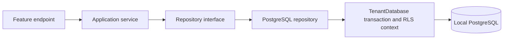

# Backend structure

The backend uses one primary type per file and namespaces that match its folders.

```text
backend/
  Pulse.Api/
    Configuration/       Service registration, middleware pipeline, setup commands
    Endpoints/           One HTTP endpoint module per feature
    Middleware/          Exceptions, request context, local identity and request quotas
    Security/            Authenticated user and tenant extraction
    Services/            HTTP/SSE streaming
    Program.cs           Application composition
  Pulse.Application/
    Abstractions/
      Repositories/      Persistence contracts
      Services/          Application service contracts
      Security/          Passwords, keys, tokens and secrets contracts
      RateLimiting/      Request and event quota contracts
      Messaging/         Notification contract
      Observability/     Instrumentation contract
    Models/              Separate identity, device, tenant, alert, telemetry and request models
    Services/            Tenant, user, bootstrap, device, key, quota, rule, alert and ingestion use cases
    Validation/          Shared input validation
  Pulse.Domain/
    Alerts/              Alert state policy
    Rules/               Event-time rule evaluation and samples
    Telemetry/           Telemetry models and event validation
  Pulse.Infrastructure/
    Configuration/       Environment secrets and strongly typed options
    DependencyInjection/ Adapter, service and repository registration
    Identity/            Identity password hashing, JWT and credential adapters
    Messaging/           Redis notification adapter
    Observability/       Metrics and readiness probing
    Persistence/         DbContext, design factory, connections and tenant transaction scope
    Processing/          Tenant job runner and rule/outbox/rollup processors
    RateLimiting/        Redis atomic quota adapters
    Repositories/        PostgreSQL repositories and retention operations
    Security/            API-key material generation
    Migrations/          Existing SQL-backed EF migration
  Pulse.Worker/
    Workers/             One hosted worker per scheduled job
    Program.cs           Worker composition
  Pulse.Tests.Unit/
    Architecture/        Service/repository dependency graph checks
    Fakes/               Focused test doubles
    Services/            Authorization and password-persistence checks
  Pulse.Tests.Integration/
    Fixtures/            Docker test prerequisite
```

The normal request flow is:



Endpoint modules apply route authorization, obtain the authenticated tenant/user, and map service results to HTTP responses. They contain no SQL. Services validate inputs and coordinate use cases through interfaces; Domain and Application reference no ASP.NET hosting, PostgreSQL, Redis or Identity packages.

Repositories own queries, row locks and atomic persistence. TenantDatabase establishes transaction-local RLS and commits the complete repository operation. Telemetry retains its explicit single transaction for ledger, raw events and outbox. LocalIdentityRepository retains the login lock/failure counter transaction and the refresh-token rotation transaction; verification and token issuance are supplied by the local identity adapter. Bootstrap checks and inserts the first administrator under the same advisory lock and transaction.

Hosted workers contain scheduling; Infrastructure owns tenant transactions, replica locks and SQL processing. Retention uses its separate privileged maintenance connection. HTTP streaming remains in the API because it owns the response stream; it reads alerts through IAlertService.

No database schema, migration identifier, route URL, role name or infrastructure provider was changed by this refactor. The existing local run commands remain the same. GlobalUsings.cs files collect shared contract/feature namespaces; dependency-injection registrations remain explicit.

To add a feature, define its application contract/model, implement its service and repository, register both in Infrastructure/DependencyInjection, and add a focused endpoint module to EndpointMappings.
