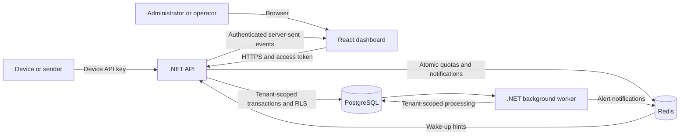

# Pulse: Client Design and Delivery Approach

## Executive summary

Pulse is a locally deployable, multi-tenant platform for receiving device telemetry, applying customer-defined rules, and presenting alerts and operational data in a web dashboard. Each tenant has its own users, devices, credentials, quotas, rules, and alerts.

The initial deployment uses .NET 10, React, PostgreSQL, and Redis on a local machine or local container environment. It does not require Azure or another cloud provider. Provider boundaries are kept explicit so infrastructure can be changed later without putting cloud dependencies into the core business logic.

## What users can do

- Sign in and manage tenant users according to their assigned role.
- Register devices and issue, rotate, or revoke device API keys.
- Submit device telemetry and review per-item processing results.
- Configure versioned rules and review alerts and their state history.
- View telemetry, alert history, and a live alert feed.
- Configure tenant request and event quotas.

The main roles are platform administrator, tenant administrator, operator, and viewer. Platform administrators provision tenants; tenant access is explicit and scoped. A platform administrator does not automatically gain access to a tenant's telemetry.

## System design

### Responsibilities

| Component | Responsibility |
|---|---|
| React dashboard | Login, administration, device and key management, rules, telemetry views, and alert workflows |
| .NET API | Authentication and authorization, HTTP endpoints, validation, quotas, and coordination of application use cases |
| PostgreSQL | Durable tenant data, identity records, telemetry, idempotency ledger, rules, alerts, outbox, and rollups |
| Redis | Shared rate counters and cross-instance notification hints; it is not the durable source of alert data |
| .NET worker | Retryable outbox processing, rule evaluation, hourly rollups, and retention/partition maintenance |

The API endpoints translate HTTP requests and responses. Application services coordinate use cases, the domain contains business rules, and infrastructure implements PostgreSQL/Redis adapters. This separation is intended to keep business behavior testable and infrastructure replaceable.

## Core workflows

### 1. Tenant and device setup

1. A platform administrator creates a tenant and its initial tenant administrator.
2. The tenant administrator registers devices and configures users and permissions.
3. The administrator issues a device key. The secret is shown once; it cannot be retrieved later. The key can be rotated or revoked.
4. Devices send telemetry with their device credential. The tenant is determined by the verified credential, not by a tenant identifier supplied in the event.

### 2. Telemetry ingestion

1. A device submits a structurally valid batch of 1–500 events.
2. The API authenticates the device and applies the tenant's event quota.
3. Each item is validated independently, including event time. The supported late-arrival window is 72 hours.
4. Event IDs are recorded in a unique tenant/device idempotency ledger. Repeated submissions return duplicate results rather than creating duplicate accepted events.
5. Accepted telemetry, its ledger entry, and its outbox work are committed atomically. A valid batch can therefore report accepted, duplicate, or rejected items without one invalid item discarding other valid items.

Request and event quotas are separate. The documented defaults are 100 requests per tenant per minute and 10,000 submitted events per tenant per minute. A structurally valid batch consumes event quota for every submitted item, including duplicates and event-level rejections. Redis is required for quota decisions; if it is unavailable, ingestion fails closed rather than silently bypassing the limit.

### 3. Rules and alerts

Rules have immutable versions so changes do not rewrite the history of earlier decisions. Threshold rules compare a window average; rate-of-change rules compare change per second in the event-time window.

To make alert outcomes deterministic when telemetry arrives late or out of order, rule evaluation waits until the 72-hour late-arrival watermark has passed. Ingestion itself remains immediate, but an alert based on new telemetry is not necessarily immediate. This is a deliberate behavior and should be included in customer expectations.

Alerts support the `OPEN → ACKNOWLEDGED → RESOLVED` and `OPEN → RESOLVED` transitions. Invalid transitions are rejected. Suppression and alert updates are coordinated in PostgreSQL so concurrent workers do not create duplicate active alerts.

The live feed uses server-sent events. Redis wakes connected API instances when there is new alert activity; PostgreSQL snapshots and replay behavior provide recovery because Redis Pub/Sub is not durable. Older alert history is available through keyset pagination.

### 4. Aggregation and retention

The worker maintains hourly rollups for dashboard queries and performs retention and partition maintenance separately from normal API requests. Raw telemetry is partitioned monthly. The documented policy retains raw telemetry and idempotency records for 90 days; because whole monthly partitions are dropped, raw telemetry's physical retention can extend to nearly 121 days. Processed outbox records are retained for 7 days.

## Security and tenant isolation

- User passwords are stored as salted password hashes, not plaintext. Access tokens are short-lived JWTs; refresh-token secrets are stored as hashes and rotated.
- Device key secrets are returned only at issuance. PostgreSQL stores a keyed digest, not the raw key. The HMAC secret is supplied through local configuration.
- Tenant authorization is checked in the API and reinforced with PostgreSQL row-level security (RLS). Tenant context is transaction-local and comes from the authenticated identity or verified device credential.
- The request-serving API uses restricted database roles. Migration and maintenance credentials are separate from normal request handling.
- Redis is used for shared quotas and notifications, not as the authoritative store for telemetry or alerts.
- Local environment secrets are generated for development and must not be committed or shared.

## Delivery and verification approach

The implementation is organized into these workstreams:

1. Establish the local API, worker, dashboard, and container-based development environment.
2. Define the PostgreSQL schema, migrations, RLS policies, reproducible SQL, and ERD.
3. Implement local identity, role-based administration, device credentials, and tenant controls.
4. Implement quotas, ingestion validation, idempotency, and atomic outbox writes.
5. Implement immutable rules, alert processing, transitions, SSE, rollups, and retention.
6. Connect the dashboard, document API/operations, and validate behavior with unit, integration, and browser tests.

The repository includes implementation across these areas. Verification should be described precisely: unit tests, frontend build/tests, browser checks, and SQL checks have passed as recorded in [verification results](verification.md). The Docker-backed integration test was skipped because Docker was unavailable on the implementation machine. Consequently, applying migrations to native PostgreSQL, real Redis quota behavior, simultaneous database sessions, and full multi-replica/SSE behavior have not been verified there. A successful build alone is not evidence that these full-stack scenarios passed.

Before a production decision, run the documented Docker/PostgreSQL/Redis checks in a suitable environment, confirm the alert delay and retention policy with stakeholders, and establish operational ownership for backups, secret rotation, monitoring, and upgrades.

## Deployment boundary and future options

The current target is local development and local deployment. The API, worker, PostgreSQL, and Redis are configured for that environment; no cloud resources are provisioned or required.

Application contracts isolate identity/token issuance, secrets, device credential validation, rate limiting, notifications, telemetry persistence, and observability. These are future integration seams, not cloud integrations that are already implemented. Any later hosted deployment would require a separate security, operations, and migration review. See the [future Azure migration plan](deployment/azure-migration-plan.md) for the documented provider mapping.

## Short client explanation

> Pulse gives each customer a securely isolated workspace for managing devices, users, telemetry rules, and alerts. Devices submit authenticated batches; the platform validates each event, prevents duplicates, and stores accepted data and follow-up work together. Background processing evaluates versioned rules and updates durable alerts, while the dashboard provides history and a live feed. The first deployment is designed to run locally without cloud dependencies, with clear interfaces for future infrastructure choices.
